# FinovaX — System Architecture Diagrams & Workflow Models

This document compiles the complete architectural, deployment, entity-relationship, and dataflow specifications for the FinovaX platform using GitHub-flavored Mermaid syntax.

---

## 1. System Architecture Diagram

High-level decomposition of FinovaX across presentation, API gateway, ML inference, and persistent data tiers.

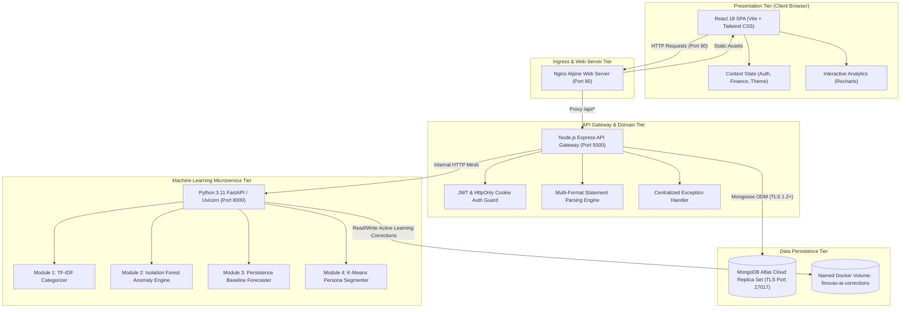

---

## 2. Docker Deployment Architecture

Docker container boundaries, isolated bridge network, and persistent storage mapping.

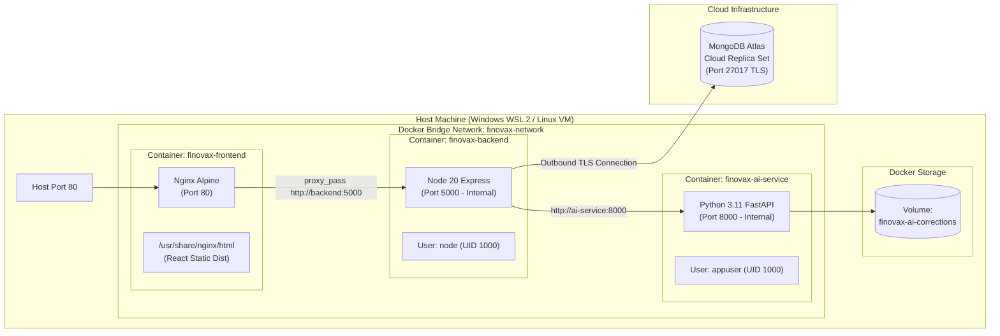

---

## 3. Frontend / Backend / AI Inter-Service Communication Flow

Step-by-step transaction analysis request pipeline.

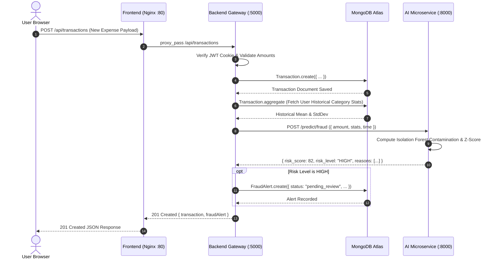

---

## 4. Database Entity-Relationship Diagram (ERD)

Mongoose schema relationships and tenant scoping across all collections.

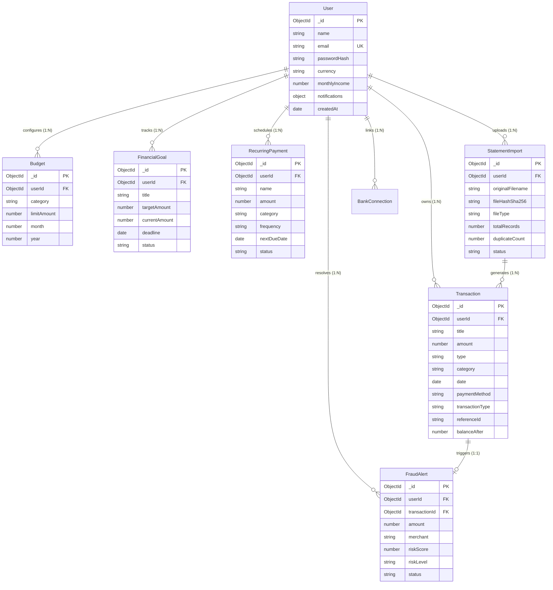

---

## 5. User Registration and Authentication Flow

Bcrypt salting, JWT token issuance, and HttpOnly cookie establishment.

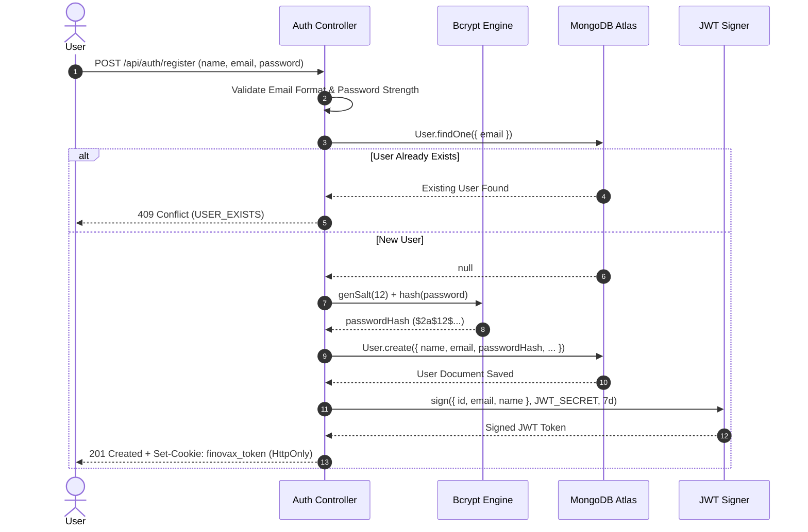

---

## 6. Transaction Processing Flow

Data ingestion, sanitization, MongoDB insertion, and real-time AI scoring.

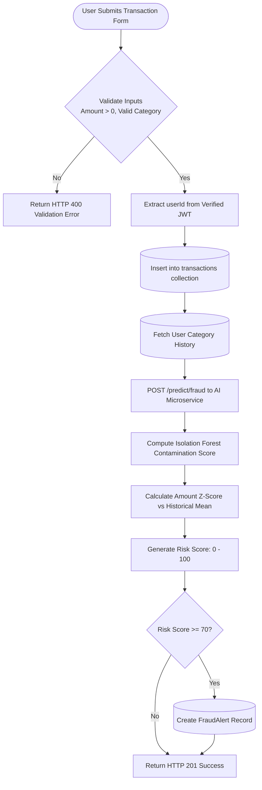

---

## 7. Statement Import Lifecycle

Multi-format ingestion, magic-byte inspection, multi-tier duplicate review, and bulk staging.

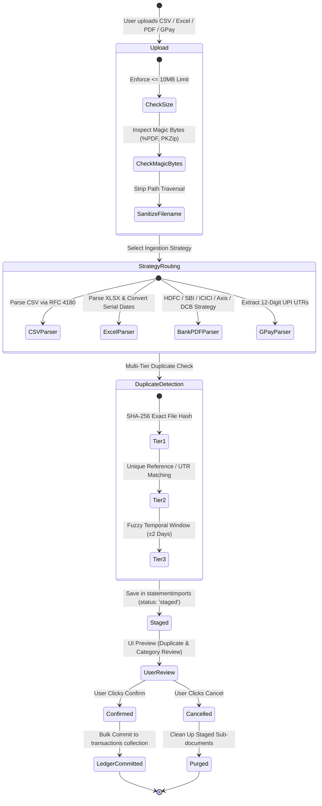

---

## 8. AI Transaction Categorization Flow

Hybrid text categorization pipeline with active learning feedback storage.

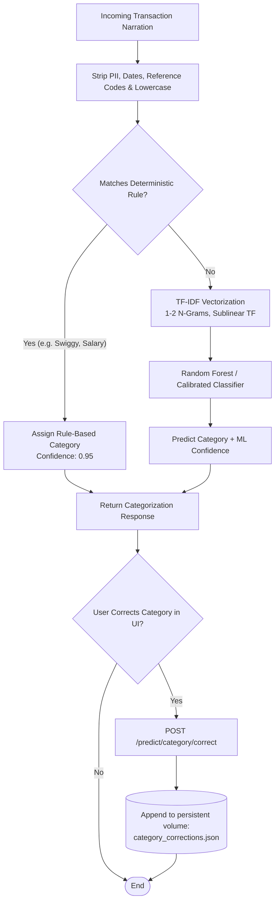

---

## 9. Fraud Intelligence Detection Flow

Isolation Forest anomaly detection combined with historical velocity analysis.

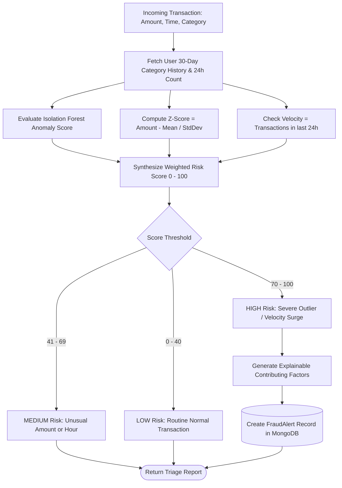

---

## 10. Spending Forecast Flow

Chronologically validated time-series expenditure prediction.

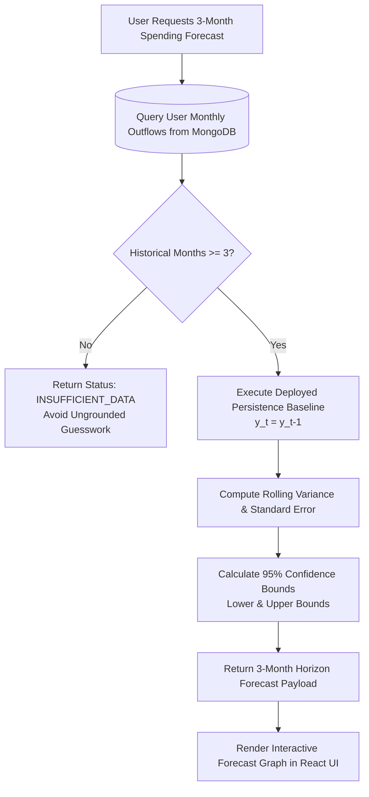

---

## 11. Customer Behavioral Segmentation Flow

Multi-attribute feature normalization and K-Means persona clustering.

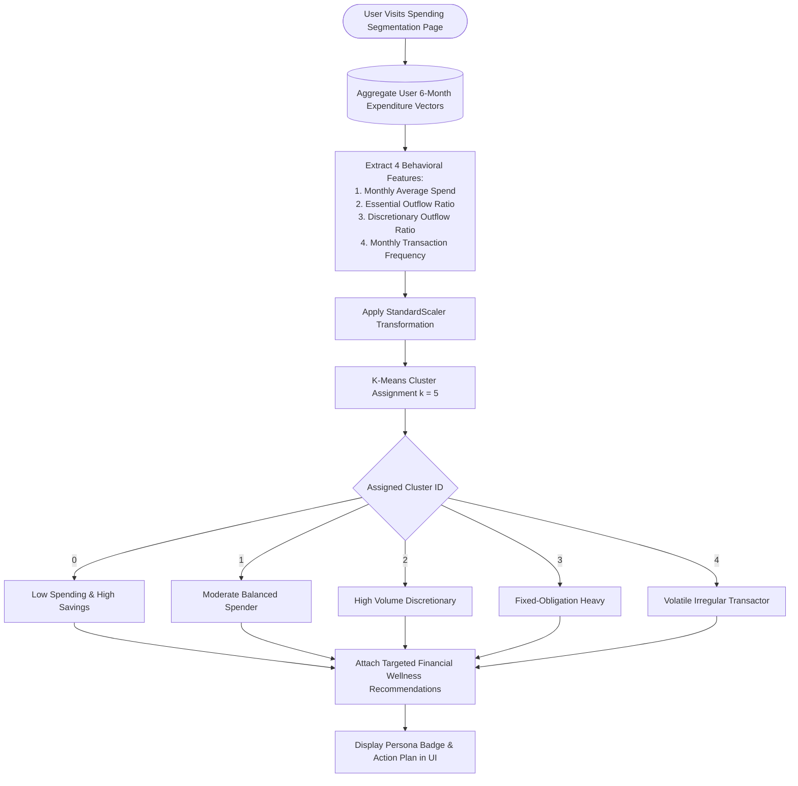

