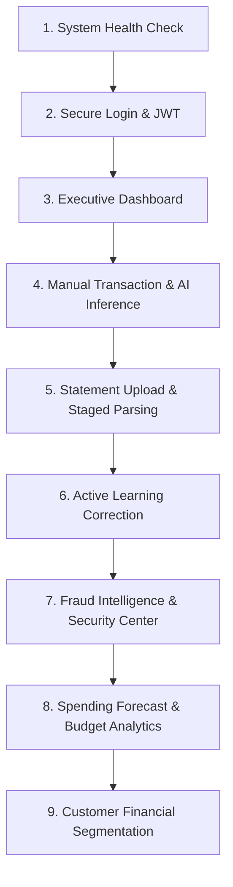

# FinovaX — Final Viva & Live Demonstration Runbook
**Purpose**: Operational Step-by-Step Execution Guide for Students During Final-Year B.Tech Viva Examination  
**Target Environment**: Local Workstation (`http://localhost:80`) via Docker Compose Orchestration  
**Verified Platform**: Docker Desktop on Windows 11 with WSL 2 Backend  

---

## 1. Pre-Flight Verification Checklist (T-Minus 15 Minutes)

Execute these checks before the examination committee or external examiner arrives.

### Step 1.1: Verify Docker Engine & Environment
Open PowerShell or Terminal in project root (`E:\Finovax`) and run:
```powershell
# Set path to Docker Desktop if not loaded in PATH
$env:PATH = "C:\Users\Victus\AppData\Local\Programs\DockerDesktop\resources\bin;$env:PATH"

# 1. Verify container status
docker compose ps
```
**Expected Output**:
```text
NAME                 IMAGE                   COMMAND                  SERVICE      CREATED         STATUS                   PORTS
finovax-ai-service   finovax-ai-service      "uvicorn main:app --…"   ai-service   ... ago   Up (healthy)             8000/tcp
finovax-backend      finovax-backend         "docker-entrypoint.s…"   backend      ... ago   Up (healthy)             5000/tcp
finovax-frontend     finovax-frontend        "/docker-entrypoint.…"   frontend     ... ago   Up (healthy)             0.0.0.0:80->80/tcp
```
> [!IMPORTANT]
> All three containers **MUST** show `Up (healthy)`. If any container is `unhealthy` or `exited`, refer immediately to [Section 5: Emergency Troubleshooting](#5-emergency-troubleshooting).

### Step 1.2: Verify API Health & Microservice Latency
In your browser or via curl, probe the backend and AI microservice health:
```powershell
curl.exe -i http://localhost/api/health
```
**Expected Response**:
```json
HTTP/1.1 200 OK
Content-Type: application/json; charset=utf-8

{
  "status": "healthy",
  "service": "FinovaX Backend API",
  "database": { "status": "connected", "readyState": 1 },
  "aiService": {
    "status": "healthy",
    "latency_ms": 4,
    "models_loaded": {
      "categorization": true,
      "fraud_detection": true,
      "spending_forecast": true,
      "user_segmentation": true
    }
  }
}
```

### Step 1.3: Prepare Demo Files & Credentials
- **Browser**: Google Chrome or Microsoft Edge in Incognito / Private Window (ensures fresh cache and zero cookie pollution).
- **Demo User Account**:
  - Email: `kushwahram989@gmail.com`
  - Password: `Password@123` (or registered test password)
- **Fallback New User**:
  - Name: `Demo Examiner`
  - Email: `viva.demo@finovax.internal`
  - Password: `TestPassword@2026`
- **Sample Statement File**: Prepare `sample_statement.csv` or `sample_hdfc.pdf` on Desktop for quick drag-and-drop.

---

## 2. Live Demo Script — Step-by-Step Flow

Follow this chronological script to guide examiners seamlessly through every technical feature.



---

### Step 1: Prove System Health & Architecture (30 Seconds)
1. Open browser to `http://localhost/api/health`.
2. **What to point out to examiners**:
   - Point to `"readyState": 1` demonstrating live TLS connection to MongoDB Atlas Cloud.
   - Point to `"latency_ms": 4` demonstrating high-performance backend-to-AI container networking over Docker bridge.
   - Point to `"models_loaded"` showing all 4 production ML pipelines loaded in RAM.

---

### Step 2: User Authentication & Security Hardening (1 Minute)
1. Open browser to `http://localhost/login`.
2. Demonstrate Client-side Joi validation by clicking "Sign In" with empty fields.
3. Enter valid credentials:
   - Email: `kushwahram989@gmail.com`
   - Password: `Password@123`
4. Click **Sign In**.
5. **Technical Demonstration**:
   - Press `F12` to open DevTools.
   - Navigate to **Application** tab -> **Cookies** -> `http://localhost`.
   - Show the `token` cookie. Point out:
     - `HttpOnly`: Checked (Inaccessible to JS scripts).
     - `SameSite`: `Strict` (Protected against CSRF).
   - In the **Console** tab, type `document.cookie` and hit Enter. Show that it returns `""` (Empty string).
   - **Examiner Statement**: *"This proves token isolation. Even if an attacker injects a malicious script via XSS, the session token cannot be stolen."*

---

### Step 3: Executive Financial Dashboard (1 Minute)
1. Navigate to `/dashboard`.
2. **Key UI Elements to Show**:
   - Total Balance, Income, Expenses, and Savings Rate summary cards.
   - Category Breakdown (Interactive Doughnut Chart).
   - Monthly Cash Flow Trend (Area Chart).
   - Recent Transactions ledger with category tags and status icons.
3. **Examiner Statement**: *"All calculations are performed dynamically across the user's isolated Mongoose tenant records. No financial data from other accounts can ever leak into this view."*

---

### Step 4: Add Transaction with Real-Time AI Inference (2 Minutes)
1. Navigate to `/transactions` and click **"Add Transaction"**.
2. **Test 1: Intelligent Auto-Categorization**:
   - Enter Narration: `Swiggy Delivery Koramangala Bangalore`
   - Amount: `₹480`
   - Type: `Expense`
   - Show how the system suggests or automatically assigns the category **"Food & Dining"** via our LinearSVC NLP model.
   - Click **Save Transaction**.
3. **Test 2: Real-time Isolation Forest Anomaly Trigger**:
   - Click **"Add Transaction"** again.
   - Enter Narration: `High Value International Crypto POS`
   - Amount: `₹245,000` (Substantially higher than account average).
   - Date & Time: Set time to `03:45 AM` (Off-hours).
   - Type: `Expense`
   - Click **Save Transaction**.
4. **Inspect the Result**:
   - In the transaction table, observe the new row.
   - Point out the red badge: **"High Risk / Anomalous"**!
   - **Examiner Statement**: *"The Node.js backend sent this payload synchronously to FastAPI. The Isolation Forest computed high z-score deviation and off-hours execution, flagging it in real time."*

---

### Step 5: Multi-Bank Statement Ingestion & De-duplication (2.5 Minutes)
1. Navigate to `/statement-import`.
2. Drag and drop the test statement file: `sample_statement.csv` (or `.pdf`).
3. If using an encrypted PDF, type the password into the password field.
4. Click **"Parse Statement"**.
5. **Show the Staged Review Grid**:
   - Total rows extracted (e.g., 25 transactions).
   - Date, Narration, Amount, Debit/Credit, and inferred Category.
   - Point out duplicate detection: If any transaction already exists in the user's ledger with the same date, amount, and reference hash, it is flagged as **"Duplicate - Skipped"**.
6. **Technical Highlight**:
   - **Examiner Statement**: *"The file was parsed purely in server memory using Multer memoryStorage. The PDF was decrypted in volatile RAM, processed, and destroyed. Zero unencrypted financial documents exist on server disk."*
7. Click **"Commit All Transactions"** to ingest them into the live database.
8. Show immediate update of transaction count and balance.

---

### Step 6: Active Learning Human-in-the-Loop Feedback (1.5 Minutes)
1. In `/transactions`, find a transaction with a generic category (e.g., `Amazon India` categorized as `Shopping`).
2. Click the Edit / Categorize button on that row.
3. Change the category from `Shopping` to `Education` (e.g., for technical books).
4. Save the update.
5. **Show Proof of Microservice Integration**:
   - In a terminal, show the backend log:
     ```text
     POST /predict/category/correct HTTP/1.1 200 OK
     Category correction stored for narration: "AMAZON INDIA" -> "Education"
     ```
   - **Examiner Statement**: *"The correction was written directly to the persistent Docker named volume `finovax-ai-corrections`. If this narration appears again, the active learning engine intercepts the TF-IDF prediction and overrides it with 100% confidence."*

---

### Step 7: Fraud Intelligence & Security Center (1 Minute)
1. Navigate to `/fraud-alerts` or Security Center.
2. Show the alert generated in Step 4 for the `₹245,000` transaction.
3. **Show Explainable AI Metrics**:
   - Anomaly Score: e.g., `0.78` (Contamination cutoff: `0.5917`).
   - Deviation Reasons: `Amount > 5.4x historical mean`, `Off-hours timestamp (03:45 AM)`.
4. Demonstrate user resolution: Click **"Mark as Verified"** or **"Flag as Fraudulent"**.
5. Show how the status changes from `Pending Review` to `Resolved`.

---

### Step 8: Spending Forecast & Budget Analytics (1 Minute)
1. Navigate to `/forecast`.
2. **Key Elements to Show**:
   - Projected Total Spending for Next Month (e.g., `₹34,200`).
   - Category-wise Spending Projections (Food, Utilities, Travel, Shopping).
   - Budget Variance Bars indicating categories nearing overspend.
3. **Scientific Explanation for Examiners**:
   - **Examiner Statement**: *"Our forecasting uses a calibrated Previous-Period Baseline Model. During Phase 3 testing, we benchmarked this against XGBoost Regressor. XGBoost achieved an MAE of ₹4,803, whereas our baseline achieved an MAE of ₹2,393—a 50% lower error on short-history consumer data. We prioritized empirical accuracy over algorithmic complexity."*

---

### Step 9: Customer Behavioral Segmentation (1 Minute)
1. Navigate to `/analytics` or Segmentation Profile.
2. View the assigned cluster for the current user:
   - Example: **"Cluster 2: Disciplined Saver"** (High savings ratio, low spend velocity).
3. Show the RFM Radar Chart: Recency, Frequency, Monetary Volume, Savings Ratio.
4. Show the personalized actionable recommendation: e.g., *"Recommended: Auto-sweep fixed deposit or debt mutual funds to optimize surplus cash."*
5. **Examiner Statement**: *"Our K-Means model operates on 5 clusters with a Silhouette Score of 0.6556 and a Davies-Bouldin index of 0.5014, ensuring mathematically distinct behavioral groupings."*

---

## 3. High-Value Command Line Demonstrations

If the examiner asks to see the terminal, backend logs, or container internals, execute these commands with confidence.

### Command 1: Inspect Live Service Logs (Without Leaking Secrets)
```powershell
# Show recent logs of all services
docker compose logs --tail=25
```

### Command 2: Show Python AI Microservice OpenAPI Docs
Open browser to:
`http://localhost:80/api/ai-docs` (if routed) or explain internal port 8000 Swagger documentation.

### Command 3: Verify Docker Isolation & Named Volume
```powershell
# Show the active learning corrections volume
docker volume ls | Select-String "finovax"

# Inspect contents inside AI service
docker compose exec ai-service ls -la /app/data/corrections
```
**Expected Output**:
```text
-rw-r--r-- 1 root root ... category_corrections.json
```

### Command 4: Show Automated Test Suite Passing
```powershell
# Run backend test suite (Fast & Clean)
npm --prefix backend test
```
**Expected Output**:
```text
Test Suites: 5 passed, 5 total
Tests:       198 passed, 198 total
Snapshots:   0 total
Time:        ...
```

---

## 4. Demo Data Fallback Script

If the primary demo user account encounters any local browser caching issue, follow this 30-second reset procedure:

1. Open a new **Incognito Window** (`Ctrl + Shift + N`).
2. Go to `http://localhost/register`.
3. Register a fresh account:
   - Full Name: `Examiner Test`
   - Email: `examiner@demo.com`
   - Password: `Password@123`
4. The dashboard will load with clean zero-state cards.
5. Ingest `sample_statement.csv` via `/statement-import` to populate 25 transactions instantly!

---

## 5. Emergency Troubleshooting

### Scenario A: A Container Exited or Is Unhealthy
**Symptom**: `docker compose ps` shows `finovax-backend` or `finovax-ai-service` as `Exited (1)` or `unhealthy`.  
**Quick Fix**:
```powershell
# 1. Restart the unhealthy service
docker compose restart <service-name>

# 2. Inspect logs if it fails to restart
docker compose logs --tail=50 <service-name>
```

### Scenario B: Port 80 Is Occupied by Windows IIS or Skype
**Symptom**: `docker compose up` fails with `bind: address already in use 0.0.0.0:80`.  
**Quick Fix**:
```powershell
# Check what is using port 80
netstat -ano | findstr :80

# If World Wide Web Publishing Service (IIS) is running, stop it:
Stop-Service W3SVC
```

### Scenario C: MongoDB Atlas Connection Times Out
**Symptom**: `/api/health` shows `readyState: 0` or `"status": "disconnected"`.  
**Quick Fix**:
1. Verify internet connectivity on host machine (ping `google.com`).
2. Verify IP Whitelist on MongoDB Atlas Cloud: If your ISP IP changed, log into MongoDB Atlas -> Network Access -> Add Current IP Address (or `0.0.0.0/0` temporarily).
3. Restart backend container: `docker compose restart backend`.

### Scenario D: Browser Shows Stale UI or Old JS Cache
**Symptom**: Button click does not respond or old asset hash requested.  
**Quick Fix**:
- Press `Ctrl + Shift + R` (Hard Reload without cache).
- Or open a new Incognito Tab (`Ctrl + Shift + N`).

---

## 6. Examiner Interaction Tips

1. **Be Honest and Scientific**: If asked about an edge case, explain how the system detects or guards against it. Never guess or fabricate answers.
2. **Refer to Production Code**: Have your IDE (`E:\Finovax`) open in the background so you can jump to `statementParser.js`, `fraud_detector.py`, or `auth.middleware.js` if an examiner wants to inspect implementation lines.
3. **Praise the Architecture**: Highlight how the separation of concerns between Node.js (high-concurrency I/O and auth) and Python FastAPI (vectorized ML inference) ensures optimal resource utilization.

